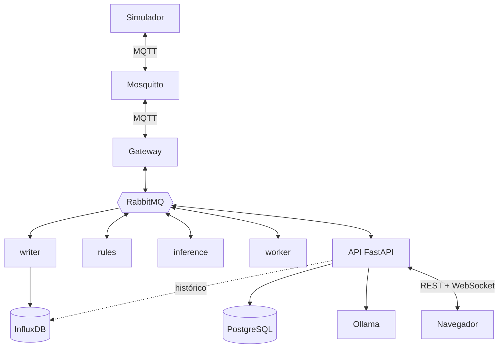

# TankVitals

**Monitoramento de tanque de aquicultura com IoT, mensageria e IA, em tempo real.**

Projeto da disciplina **Web II, UniFACEF 2026**. Este README descreve o
2º bimestre; o 1º bimestre (ESP32 no Wokwi, MQTT e InfluxDB) continua no
histórico do Git e na [ARQUITETURA §1–10](docs/ARQUITETURA.md).

---

## 1. O problema

Tanques de criação de peixes dependem de uma faixa estreita de qualidade da
água. Fora dela, o prejuízo é rápido: oxigênio baixo mata em horas, e a bomba
de recirculação, quando quebra, para a filtragem e a oxigenação de uma vez.

O acompanhamento costuma ser manual: alguém mede uma ou duas vezes por dia e só
percebe a bomba quando ela já parou. O TankVitals mede tudo continuamente, age
sozinho quando o oxigênio cai e usa IA para avisar que a bomba vai falhar antes
de ela falhar.

### O que o sistema vigia

| Parte | Variáveis | O que acontece |
| --- | --- | --- |
| Água do tanque | temperatura, pH, nível, turbidez, oxigênio dissolvido, luminosidade | dashboard ao vivo, histórico e alerta fora da faixa |
| Bomba de recirculação | vibração, corrente, temperatura do motor, vazão | a IA estima a saúde e a vida útil restante |
| Aerador | ligado ou desligado | liga sozinho quando o oxigênio cai abaixo de 5 mg/L e desliga em 6,5 |
| Reposição de água | ligada ou desligada | ligada pelo botão na Web; a tela espera o dispositivo confirmar |

As faixas de cada variável ficam no cadastro do PostgreSQL e podem ser
editadas pela tela **Dispositivos**.

---

## 2. Arquitetura



| Peça | Papel |
| --- | --- |
| **Simulador** | faz o papel do dispositivo: gera as leituras, obedece aos comandos e simula falhas na bomba |
| **Mosquitto** | broker MQTT da borda, com usuário, senha e ACL por cliente |
| **Gateway** | ponte entre os brokers: MQTT → RabbitMQ para leituras, RabbitMQ → MQTT para comandos |
| **RabbitMQ** | barramento interno: uma fila por serviço, nova tentativa com espera e DLQ para o que falhar |
| **writer** | grava leituras e previsões no InfluxDB, sem gravar a mesma mensagem duas vezes |
| **rules** | regra automática do aerador e alertas de faixa |
| **inference** | aplica os modelos treinados na bomba ao vivo: saúde, vida útil restante e alertas |
| **worker** | trabalhos demorados (gerar dados sintéticos e treinar) sem travar a API |
| **API** | única porta do navegador: REST, WebSocket com ticket, login JWT e o assistente |
| **InfluxDB** | séries temporais das leituras e das previsões |
| **PostgreSQL** | usuários, dispositivos, faixas, regras, alertas, auditoria e registros da IA |
| **Ollama** | LLM local (`llama3.2:3b`) do assistente, sem nuvem e sem chave de API |
| **Navegador** | app Vue 3 com dashboard, cena 3D e as telas de IA, servido pelo nginx na porta 8080 |

### Os três fluxos

1. **IoT → Web:** simulador → Mosquitto → gateway → RabbitMQ. O writer grava no
   InfluxDB e, ao mesmo tempo, a API recebe pela fila `q.ws` e empurra pelo
   WebSocket. Dashboard e 3D atualizam sozinhos.
2. **Web → IoT:** botão no dashboard → API → RabbitMQ → gateway → Mosquitto →
   simulador liga o atuador. A mudança volta pelas leituras seguintes.
3. **IA:** o Laboratório pede os dados sintéticos e o Treinamento pede os
   modelos, os dois pela fila do worker. O inference aplica o modelo aceito na
   telemetria ao vivo, e saúde, vida útil e alertas voltam pelo RabbitMQ até a
   Insights e as cores do 3D.

Contratos completos (tópicos, envelope, filas, bancos e rotas):
[docs/ARQUITETURA.md](docs/ARQUITETURA.md), §11 a §17.

---

## 3. Como subir

**Requisitos:** Docker Desktop com pelo menos 8 GB de memória para o WSL, e
Python 3.11 ou mais novo (só para gerar os segredos; o script não usa
dependências).

Na raiz do repositório:

```powershell
python scripts/gerar_segredos.py
docker compose up -d --build
docker compose ps
```

1. O gerador cria o `.env` e a pasta `secrets/`, os dois fora do Git, e
   imprime uma vez as senhas dos usuários de demonstração. Anote-as.
2. A primeira subida baixa as imagens e o modelo do assistente (cerca de 2 GB).
   O sistema não espera pelo modelo: enquanto ele baixa, a tela do assistente
   avisa que está carregando.
3. Abra <http://localhost:8080> e entre com um dos usuários abaixo.

Para parar, `docker compose down`. **Não use `down -v`**: ele apaga os dados e
o modelo baixado.

### Usuários de demonstração

| Usuário | Pode |
| --- | --- |
| `viewer` | ver tudo, sem comandar nada |
| `operator` | o mesmo, mais ligar e desligar os atuadores |
| `admin` | tudo: cadastro, gerar dados, treinar e auditoria |

As senhas são as `DEMO_*_PASSWORD` do `.env` gerado. Cinco senhas erradas
seguidas bloqueiam a conta por 5 minutos. O login vale 2 horas.

### Endereços

| O quê | Onde |
| --- | --- |
| Aplicação | <http://localhost:8080> |
| Documentação da API | <http://localhost:8080/api/docs> |
| RabbitMQ Management | <http://127.0.0.1:15672> |
| InfluxDB | <http://127.0.0.1:8086> |
| pgAdmin (PostgreSQL já cadastrado) | <http://127.0.0.1:5050> |

Só a porta 8080 fica aberta para a rede; as outras atendem apenas a própria
máquina. Os logins das ferramentas estão no `.env`.

---

## 4. As telas

| Tela | O que mostra |
| --- | --- |
| **Dashboard** | leituras ao vivo, gráfico do histórico e indicadores (mínimo, máximo, média, tempo fora da faixa, quantas vezes o atuador ligou); botões dos atuadores |
| **Gêmeo 3D** | o tanque e a bomba em 3D, com as cores da faixa; a bomba treme quando a IA prevê falha |
| **Dispositivos** | cadastro de dispositivos, variáveis e faixas (admin) |
| **Laboratório** | gera a base sintética de treino, com acompanhamento do job |
| **Treinamento** | treina os modelos, compara com a base e mostra as métricas |
| **Insights** | saúde e vida útil da bomba, tendência e alertas da IA |
| **Assistente** | perguntas em linguagem natural sobre o tanque, respondidas pelo LLM local com os dados atuais |
| **Mensageria** | filas, taxas e consumidores do RabbitMQ, últimas mensagens e a DLQ |
| **Auditoria** | quem fez o quê: logins, comandos e mudanças no cadastro (admin) |
| **Ferramentas** | atalhos para a documentação da API e as ferramentas de cada serviço |

No menu do usuário há o modo de alto contraste.

---

## 5. Demonstração em comandos

```powershell
# Mensagens MQTT chegando no broker
docker compose exec mosquitto sh -c 'mosquitto_sub -u gateway -P "$MQTT_GATEWAY_PASSWORD" -t "tankvitals/+/+/+/telemetry" -v'

# Parar o writer: a fila q.writer cresce na Mensageria; ao voltar, esvazia
docker compose stop writer
docker compose start writer

# Parar o simulador: o dashboard e o 3D avisam que estão sem dados
docker compose stop simulator
docker compose start simulator
```

A falha da bomba é simulada pela tela **Gêmeo 3D**, entrando como `operator`
ou `admin`: escolha o modo (rolamento, entupimento, superaquecimento ou
desbalanceamento) e, em poucos minutos, a saúde e a vida útil caem na Insights,
o alerta abre e a bomba fica crítica no 3D. **Reparar** devolve a bomba ao
estado de nova.

O roteiro completo da apresentação está em
[docs/ROTEIRO-APRESENTACAO.md](docs/ROTEIRO-APRESENTACAO.md).

---

## 6. Segurança

- Nenhuma senha ou chave no repositório: o `.env` e o `secrets/` são gerados na
  máquina e ignorados pelo Git.
- Cada serviço tem o próprio usuário no Mosquitto, no RabbitMQ e no InfluxDB,
  com permissão só no que usa.
- Login com JWT e três papéis, conferidos na API; o WebSocket abre com um ticket
  de uso único.
- Bloqueio por tentativas no login e limite de perguntas por minuto no
  assistente.
- Containers sem root e só a porta 8080 exposta à rede.

---

## 7. Estrutura do repositório

```
TankVitals/
├─ compose.yaml            <- ponto de entrada do `docker compose up`
├─ backend/
│  ├─ app/
│  │  ├─ simulator/        <- dispositivo simulado (sensores, bomba, atuadores)
│  │  ├─ gateway/          <- ponte MQTT ↔ RabbitMQ
│  │  ├─ writer/           <- RabbitMQ → InfluxDB
│  │  ├─ rules/            <- regra do aerador e alertas de faixa
│  │  ├─ inference/        <- modelos ao vivo
│  │  ├─ worker/           <- jobs de dados e treino
│  │  ├─ core/             <- cadastro, login, física da bomba e seed
│  │  ├─ assistant/        <- contexto e conversa com o Ollama
│  │  └─ main.py           <- API FastAPI
│  └─ tests/
├─ frontend/               <- Vue 3 + TypeScript + Vite, nginx
├─ infra/                  <- docker-compose, Mosquitto, RabbitMQ, pgAdmin
├─ scripts/                <- gerador de segredos e bootstrap dos tokens
├─ firmware/wokwi/         <- ESP32 do 1º bimestre
└─ docs/
```

### Documentação

| Documento | Para quê |
| --- | --- |
| [ARQUITETURA.md](docs/ARQUITETURA.md) | contratos entre as partes |
| [TAREFAS-2BIM.md](docs/TAREFAS-2BIM.md) | tarefas do bimestre, por frente |
| [IA.md](docs/IA.md) | física da bomba, dados sintéticos, modelos e métricas |
| [ROTEIRO-APRESENTACAO.md](docs/ROTEIRO-APRESENTACAO.md) | roteiro da apresentação |
| [PADROES-DESENVOLVIMENTO.md](docs/PADROES-DESENVOLVIMENTO.md) | branch, commit e PR |

### Testes

```powershell
cd backend
python -m pytest tests ../scripts/tests -q
cd ../frontend
npm run build
```
