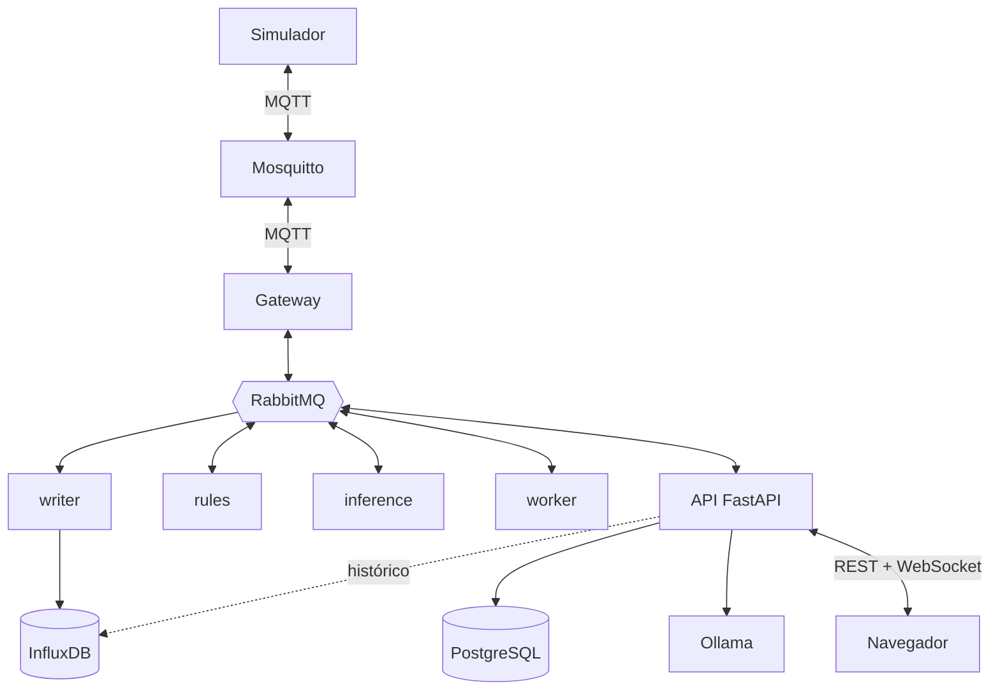

# TankVitals — Tarefas do 2º bimestre

As tarefas do 2º bimestre, divididas em 5 frentes, uma por pessoa. Cada frente
faz a sua parte de ponta a ponta, incluindo a tela, e apresenta o que fez.
**Apresentação: segunda, 16/11.**

| Frente | O que faz | Critérios da rubrica (1 pt cada) | Carga |
| --- | --- | --- | --- |
| **PLAT** — Plataforma e mensageria | Compose, segredos, Mosquitto, RabbitMQ, página Mensageria | Compose e apresentação · RabbitMQ | ~30 h |
| **IOT** — Dispositivo e controle | simulador, gateway, atuadores, aerador automático, botões | Sensores e MQTT · Regra e controle Web | ~29 h |
| **BACK** — Backend e assistente | PostgreSQL, login, WebSocket, cadastro, auditoria, LLM | PostgreSQL e InfluxDB · Segurança · metade de Insights e LLM | ~37 h |
| **WEB** — Interface e 3D | casca do app, dashboard, telas de cadastro, cena 3D | Dashboard ao vivo · Interface 3D | ~34 h |
| **IA** — Inteligência artificial | modelo físico, gerador de dados, treino, inferência, Insights | Dados e modelos · metade de Insights e LLM | ~40 h |

---

## Arquitetura

O tanque continua o mesmo do 1º bimestre, com uma novidade: a **bomba de
recirculação** passa a ser vigiada para manutenção preditiva. O ESP32 sai e
entra um simulador em Python. No meio do caminho entram um barramento de
mensagens (RabbitMQ), um banco relacional (PostgreSQL), os modelos de IA e um
assistente com LLM local. Tudo sobe com `docker compose up`.

### O que o sistema vigia

- **Água do tanque:** temperatura, pH, nível e turbidez (do 1º bimestre), mais oxigênio dissolvido e luminosidade.
- **Bomba de recirculação**, o equipamento monitorado: vibração, corrente, temperatura do motor e vazão. É ela que a IA acompanha.
- **Atuadores:** o aerador, que liga sozinho quando o oxigênio cai, e a bomba de reposição, ligada pelo botão na Web.

### O desenho

### Peça por peça

- **Simulador** (IOT) — faz o papel do dispositivo: gera as leituras dos sensores e da bomba, obedece aos comandos e consegue simular falhas.
- **Mosquitto** (PLAT) — o broker MQTT, na borda. Só o simulador e o gateway falam com ele, cada um com usuário e senha.
- **Gateway** (IOT) — a ponte entre os dois brokers: o que chega pelo MQTT vai para o RabbitMQ, e os comandos fazem o caminho inverso.
- **RabbitMQ** (PLAT) — o barramento interno. Cada serviço tem a sua fila e lê só dela. Se um serviço para, a fila dele acumula e esvazia quando ele volta. O que dá erro vai para a DLQ, sem se perder.
- **writer** (PLAT) — grava as leituras e as previsões da IA no InfluxDB.
- **rules** (IOT) — a regra automática: acompanha o oxigênio e liga ou desliga o aerador.
- **inference** (IA) — aplica os modelos treinados na bomba ao vivo e publica a saúde, a vida útil restante e os alertas.
- **worker** (IA) — os trabalhos demorados, gerar os dados sintéticos e treinar os modelos, sem travar a API.
- **API** (BACK) — a única porta do navegador: REST para consultas e comandos, WebSocket para o que é ao vivo. Também é ela que conversa com o Ollama.
- **InfluxDB** (PLAT) — séries temporais: as leituras e as previsões ao longo do tempo.
- **PostgreSQL** (BACK) — o que é cadastro e registro: usuários, dispositivos, regras, alertas e auditoria.
- **Ollama** (BACK) — o LLM rodando na própria máquina, sem nuvem e sem chave de API.
- **Navegador** (WEB) — o app em Vue com o dashboard, as telas e a cena 3D, servido pelo nginx na porta 8080.

### Os três fluxos que a apresentação mostra

1. **IoT → Web:** simulador → Mosquitto → gateway → RabbitMQ. Dali o writer grava no InfluxDB e, ao mesmo tempo, a API recebe pela fila `q.ws` e empurra pelo WebSocket: dashboard e 3D atualizam sozinhos.
2. **Web → IoT:** botão no dashboard → API → RabbitMQ → gateway → Mosquitto → simulador liga o atuador. A mudança aparece nas leituras seguintes, que voltam pelo fluxo 1.
3. **IA:** o Laboratório manda gerar os dados (fila → worker), o treino cria os modelos (fila → worker) e o inference aplica os modelos na telemetria que chega. Saúde, vida útil e alertas voltam pelo RabbitMQ até a página Insights e as cores do 3D.

---

## PLAT — Plataforma e mensageria

- [ ] **PLAT-01 · Contratos na ARQUITETURA.md** — fazer primeiro, as outras frentes dependem\
  Com 5 pessoas trabalhando ao mesmo tempo, os nomes precisam estar combinados
  antes; senão as peças não encaixam na hora de juntar. Escrever:
  - o formato único das mensagens, `{id, ts, type, device, payload}`, com um exemplo de cada tipo (telemetria, comando, insight, alerta, progresso de job);
  - os tópicos MQTT: `tankvitals/<zona>/<tipo>/<device>/telemetry` e `.../cmd`;
  - as exchanges, as routing keys (`telemetry.<zona>.<tipo>.<device>`) e as filas, com quem consome cada uma;
  - os ids do cadastro (`od-01`, `bomba-rec-01`, `aerador-01`...) e as faixas normais de cada variável;
  - as tabelas do PostgreSQL e a lista de rotas da API (nome e para que serve).

  *Pronto:* uma pessoa de cada frente revisou e aprovou.

  *Proposta escrita:* `docs/ARQUITETURA.md`, da §11 à §17, a partir do que o front já usa no modo simulado. Falta a revisão de cada frente.

- [ ] **PLAT-02 · Script de segredos**\
  O enunciado proíbe senha no Git e senha padrão do tipo admin/admin. A saída é
  um script que gera tudo na máquina de cada um.
  - Criar `scripts/gerar_segredos.py` em Python puro, para rodar igual no Windows e no Linux.
  - Gerar senha aleatória (`secrets.token_urlsafe`) para o Mosquitto, cada usuário do RabbitMQ, o PostgreSQL, o InfluxDB, o pgAdmin, a chave do JWT e os 3 usuários de demo.
  - Gravar em `.env` e na pasta `secrets/`, os dois no `.gitignore`.
  - Gerar também o `definitions.json` do RabbitMQ (PLAT-05), que leva as senhas.
  - Não sobrescrever o que já existe (`--force` para gerar de novo) e mostrar as senhas de demo no terminal.
  - No compose, usar `${VAR:?rode scripts/gerar_segredos.py}`: sem segredo, ele para com essa mensagem em vez de subir com senha fraca.

  *Pronto:* nenhuma senha no Git; sem `secrets/`, o compose nem sobe.

- [ ] **PLAT-03 · Compose único**\
  O enunciado pede que tudo suba com um só comando, em qualquer máquina com
  Docker, com todos os serviços saudáveis.
  - `compose.yaml` na raiz, sem perfis, com: frontend, api, gateway, writer, rules, inference, worker, simulator, migrate, mosquitto, rabbitmq, postgres, pgadmin, influxdb e ollama.
  - Os serviços Python usam a mesma imagem do `backend/`, cada um com o seu comando (`python -m app.writer`...).
  - Healthcheck em todos: `pg_isready`, `rabbitmq-diagnostics ping`, `influx ping`, `/api/health`.
  - Ordem de subida com `depends_on` e `condition: service_healthy`: bancos e brokers → migrate → serviços Python → simulador e frontend.
  - Volumes para os dados: InfluxDB, PostgreSQL, RabbitMQ, modelos do Ollama, datasets gerados e modelos treinados.

  *Pronto:* `docker compose up` deixa tudo `healthy` em menos de 5 min, e derrubar e subir de novo não perde dados.

- [ ] **PLAT-04 · Mosquitto com senha e ACL**\
  O broker MQTT não pode aceitar qualquer um, e cada cliente só pode usar os
  tópicos dele.
  - `allow_anonymous false` no `mosquitto.conf`.
  - Arquivo de senhas, gerado pelo script, com os usuários `simulator` e `gateway`.
  - ACL: o simulador publica em `.../telemetry` e lê os `.../cmd`; o gateway faz o contrário.
  - A porta 1883 aberta só em `127.0.0.1`.

  *Pronto:* `mosquitto_sub` sem senha é recusado, e o simulador não consegue publicar num `/cmd`.

- [ ] **PLAT-05 · Filas e usuários do RabbitMQ**\
  O RabbitMQ é o barramento interno: cada serviço lê a própria fila. A
  estrutura é declarada uma vez, quando o broker sobe, e não por cada serviço.
  - Exchanges: `tv.telemetry`, `tv.commands`, `tv.insights` e `tv.events` (tipo topic), `tv.jobs` (direct) e `tv.dlx` para as mensagens mortas.
  - Filas e consumidores: `q.writer` (writer), `q.inference` (inference), `q.rules` (rules), `q.ws` (API), `q.commands` (gateway), `q.jobs.datagen` e `q.jobs.train` (worker) e `q.dlq`.
  - Toda fila com `x-dead-letter-exchange: tv.dlx`, para o que falhar cair na DLQ.
  - Um usuário por serviço, que só lê a sua fila e só escreve na exchange em que publica. O usuário da API tem a tag `monitoring`, para a página Mensageria. Sem `guest`.
  - Tudo num `definitions.json`, carregado pelo `rabbitmq.conf`.

  *Pronto:* as filas aparecem na interface do RabbitMQ logo depois de subir, antes de qualquer serviço conectar.

- [ ] **PLAT-06 · Writer (fila → InfluxDB)**\
  É o consumidor que guarda o histórico. É com ele que a apresentação mostra o
  efeito de um consumidor parado.
  - Consumir `q.writer` com `aio-pika`, buscando várias mensagens de uma vez (`prefetch` de umas 200).
  - Gravar em lote no InfluxDB: telemetria no bucket `tankvitals`, com o dispositivo e a zona como tags, e previsões da IA no measurement `insight`.
  - Confirmar (ack) a mensagem só depois de gravar.
  - Se a gravação falhar 3 vezes, rejeitar sem devolver à fila: a mensagem vai para a DLQ.

  *Pronto:* parar o writer faz a fila crescer, e voltar esvazia sem perder ponto.

- [ ] **PLAT-07 · Página Mensageria**\
  O enunciado pede uma tela que mostre o RabbitMQ trabalhando ao vivo. O
  navegador nunca fala direto com o broker: quem consulta é o backend.
  - Rota `GET /api/messaging`, que consulta a API de gerenciamento do RabbitMQ (`/api/queues`, `/api/overview`, `/api/consumers`).
  - Últimas mensagens: guardar as 50 últimas que passaram pela `q.ws`.
  - DLQ: quantidade e uma amostra, lida sem tirar da fila (`ackmode: ack_requeue_true`).
  - Tela: por fila, mensagens prontas e pendentes, taxas de publicação e de entrega e consumidores conectados, atualizando a cada 2 s, com um mini gráfico do tamanho de cada fila.

  *Pronto:* dá para ver ao vivo a fila do writer crescer quando ele para e esvaziar quando volta.

- [ ] **PLAT-08 · Porta única e sem root**\
  São itens de segurança do enunciado: só a porta do front aberta e os
  containers da aplicação sem root.
  - No nginx do frontend, repassar `/api` e `/ws` para a API (com os cabeçalhos de upgrade do WebSocket). A API deixa de publicar porta.
  - Na rota do assistente, `proxy_buffering off`, senão o streaming do LLM chega todo de uma vez.
  - `nginx-unprivileged` no front e `USER app` no Dockerfile Python.
  - InfluxDB, RabbitMQ e pgAdmin publicados só em `127.0.0.1`.

  *Pronto:* `docker compose ps` mostra só a 8080 aberta, e `whoami` nos containers da aplicação não responde `root`.

---

## IOT — Dispositivo e controle

- [ ] **IOT-01 · Simulador**\
  O enunciado troca o ESP32 por um dispositivo simulado em Python. São 9
  dispositivos: os 4 sensores da água que já existem, oxigênio dissolvido
  (`od-01`), luminosidade (`luz-01`), a bomba de recirculação (`bomba-rec-01`,
  com vibração, corrente, temperatura do motor e vazão) e os dois atuadores,
  aerador (`aerador-01`) e reposição (`bomba-repo-01`).
  - Criar o serviço `backend/app/simulator/`, conectando no Mosquitto com usuário e senha.
  - A cada passo, publicar uma mensagem por dispositivo, no formato combinado, em `tankvitals/<zona>/<tipo>/<device>/telemetry`.
  - Pôr ciclo de dia e noite: a luz, a temperatura da água e o oxigênio variam ao longo do dia.
  - Configurar o Last Will em `tankvitals/sim/status`, para o sistema saber quando o simulador cai.

  *Pronto:* `mosquitto_sub` mostra os 9 dispositivos chegando.

- [ ] **IOT-02 · Gateway MQTT ↔ RabbitMQ**\
  É a ponte entre os dois brokers. O Mosquitto fica na borda, com o
  dispositivo; o RabbitMQ é o barramento de dentro.
  - Assinar a telemetria (`tankvitals/+/+/+/telemetry`) e o status do simulador.
  - Validar cada mensagem (pydantic) e republicar em `tv.telemetry`, com a routing key tirada do tópico: é só trocar `/` por `.`.
  - Mensagem inválida: publicar em `tv.dlx`, com o corpo original intacto e o motivo num header.
  - Consumir `q.commands` e publicar no `/cmd` do dispositivo, confirmando só depois de publicar.
  - Reconectar sozinho se o Mosquitto ou o RabbitMQ reiniciar. `aiomqtt` evita misturar thread e asyncio.

  *Pronto:* um JSON quebrado publicado no MQTT aparece na DLQ, e reiniciar o RabbitMQ não derruba o gateway.

- [ ] **IOT-03 · Atuadores que reagem**\
  O enunciado exige que o atuador mude de estado e que isso apareça nas
  leituras seguintes.
  - O simulador assina os `/cmd` e guarda o estado de cada atuador.
  - O estado entra no cálculo do próximo passo: aerador ligado → oxigênio sobe; reposição ligada → nível sobe; bomba de recirculação desligada → vazão e corrente vão a zero e a turbidez sobe aos poucos.
  - Cada atuador publica a própria telemetria com o estado (`{"on": true}`). É a confirmação de que o comando chegou.
  - Comando malformado vira log, sem derrubar o simulador.

  *Pronto:* ligar um atuador e ver o efeito nas leituras seguintes.

- [ ] **IOT-04 · Rota de comando**\
  É o começo do fluxo Web → IoT: o botão chama a API, e a API publica o comando
  no barramento.
  - `POST /api/devices/{id}/command`, só para operador e admin.
  - Validar se o dispositivo existe e aceita aquele comando (`on`, `inject_fault`, `repair`).
  - Gravar o comando na tabela de comandos e na auditoria: quem, quando e o quê.
  - Publicar em `tv.commands`, com a routing key do dispositivo.
  - Não devolver o "novo estado": quem confirma é a telemetria do atuador.

  *Pronto:* o comando sai da API e chega ao simulador.

- [ ] **IOT-05 · Botões na tela**\
  É o lado visual do controle, usado no dashboard e no painel do 3D.
  - Componente de atuador: estado atual, botão de liga/desliga e "aguardando confirmação" até a telemetria confirmar.
  - Esconder os botões de quem é só visualizador.
  - Painel do simulador (operador): escolher um modo de falha e injetar, e um botão de reparar.
  - Mostrar o erro se a API recusar o comando.

  *Pronto:* o botão liga a reposição, o estado muda quando a telemetria confirma e o nível sobe.

  *Já existe no front:* `frontend/src/components/ActuatorControl.vue` (estado, botão, "aguardando confirmação", erro e esconder do visualizador), usado no dashboard e no painel do 3D, e `frontend/src/components/FaultControl.vue` (o painel do simulador: modo de falha, injetar e reparar), no painel da bomba no 3D. Falta a parte da API e do simulador.

- [ ] **IOT-06 · Bomba com o modelo físico** — depende da IA-01\
  A IA treina com dados gerados por um modelo físico da bomba. Se o simulador
  usar outra física, o modelo treinado não reconhece a bomba ao vivo.
  - Trocar a bomba provisória do simulador pelo `physics.py` da IA-01, chamando com uma bomba só.
  - Usar o mesmo passo do gerador: 1 leitura = 1 minuto simulado.
  - Variável `SIM_SPEED` (padrão 60): 1 s real = 1 min simulado. Um dia dura 24 min e uma falha leva uns 6 min.
  - Conferir com a IA que as leituras ao vivo parecem com as do gerador.

  *Pronto:* a bomba saudável tem ruído (não é uma reta), e um dia simulado dura 24 min.

- [ ] **IOT-07 · Aerador automático**\
  É o atuador acionado por regra de negócio. O oxigênio cai à noite: o aerador
  liga sozinho, o oxigênio sobe e ele desliga.
  - Serviço `rules`, que consome `q.rules` e lê as regras do PostgreSQL, recarregando de tempos em tempos.
  - Regra com dois limites: liga com OD < 5 mg/L e desliga com OD ≥ 6,5. A diferença evita o liga-desliga a cada leitura.
  - Guardar o último comando enviado, para publicar um só por mudança, não um por leitura.
  - Publicar o comando em `tv.commands` com origem "regra" e registrar na tabela de comandos.
  - Abrir e fechar os alertas de faixa (sensor fora do normal).

  *Pronto:* à noite o OD cai, o aerador liga sozinho e desliga quando o OD sobe.

- [ ] **IOT-08 · Falha injetada**\
  É o que dá à IA o que mostrar na apresentação: a bomba começa a falhar ao vivo.
  - Comando `inject_fault` com o modo (rolamento, filtro entupido, superaquecimento, desbalanceamento): a bomba degrada aos poucos até quebrar, em uns 6 min.
  - Comando `repair`: a bomba volta ao estado de nova.
  - A telemetria nunca leva o rótulo (horas até a falha, saúde, modo de falha), senão o modelo "cola" na prova.
  - Teste automatizado conferindo que nenhuma mensagem publicada tem esses campos.

  *Pronto:* a vibração e a temperatura sobem aos poucos, não de uma vez, e o teste passa.

---

## BACK — Backend e assistente

- [ ] **BACK-01 · Código em serviços**\
  O backend deixa de ser um processo só e vira vários serviços pequenos, todos
  no mesmo código Python.
  - Estrutura `backend/app/<serviço>/` para api, gateway, writer, rules, inference, worker e simulator, cada um com um `__main__.py`.
  - Código compartilhado em `core/`: formato das mensagens, configuração, conexão com o RabbitMQ, `physics.py` e `features.py`.
  - Uma imagem Docker só; cada serviço do compose roda `python -m app.<serviço>`.
  - `aio-pika` como biblioteca do RabbitMQ em todos os serviços.
  - Dependências novas: `aio-pika`, `aiomqtt`, `sqlalchemy`, `psycopg`, `alembic`, `pyjwt`, `bcrypt`, `numpy`, `pandas`, `pyarrow` e `scikit-learn`.

  *Pronto:* `python -m app.<serviço>` roda para cada serviço.

- [ ] **BACK-02 · PostgreSQL**\
  O InfluxDB continua com as leituras, que são séries no tempo. O PostgreSQL
  fica com o que é cadastro e registro, que tem relação entre si e é editado.
  - Modelos com SQLAlchemy e migrações com Alembic.
  - Tabelas: usuários, dispositivos, faixas de cada variável, regras, alertas, comandos, auditoria, jobs e versões de modelo.
  - Seed com o cadastro inicial (sensores, bomba, atuadores, faixas e a regra do aerador) e os usuários de demo.
  - Serviço `migrate` no compose, que aplica tudo e encerra antes de os outros subirem.

  *Pronto:* `docker compose up` cria tudo sozinho, e rodar de novo não duplica o seed.

- [ ] **BACK-03 · Login e papéis**\
  O enunciado pede login com JWT e três papéis. O visualizador só vê; o
  operador comanda atuadores e o simulador; o admin também edita o cadastro,
  gera dados, treina e vê a auditoria.
  - `POST /api/auth/login`, devolvendo um JWT de 30 min (`PyJWT`).
  - Senhas com `bcrypt` direto (o `passlib` está sem manutenção).
  - Uma dependência do FastAPI que exige o papel em cada rota: `require_role("operator")`.
  - Bloquear o usuário por 5 min depois de 5 senhas erradas seguidas.
  - Registrar todo login, certo ou errado, na auditoria.

  *Pronto:* o visualizador leva 403 ao comandar, e a 6ª senha errada leva 429.

- [ ] **BACK-04 · WebSocket com ticket**\
  É o que deixa a tela ao vivo. O JWT não pode ir na URL, porque fica em log e
  no histórico do navegador, então o navegador usa um ticket curto.
  - `POST /api/ws/ticket` (com JWT), devolvendo um ticket aleatório que vale 30 s e uma vez só.
  - `/ws/live?ticket=...` só aceita a conexão com ticket válido.
  - A API consome a fila `q.ws` e repassa cada mensagem a todos os navegadores conectados.
  - Quem desconectou sai da lista sem afetar os outros.

  *Pronto:* ticket reusado é recusado, e duas abas recebem a mesma leitura em menos de 1 s.

- [ ] **BACK-05 · Leitura: cadastro, histórico e alertas**\
  São as rotas que o dashboard, o 3D e o assistente usam para ler os dados.
  - `GET /api/devices`: os dispositivos com as faixas normais, de onde saem as cores do dashboard e do 3D.
  - Histórico por dispositivo e variável, do InfluxDB, com agregação por período (1 h, 24 h, 7 dias).
  - `GET /api/alerts`: os alertas abertos e o histórico.

  *Pronto:* 24 h de histórico de qualquer variável em menos de 1 s.

- [ ] **BACK-06 · Cadastro editável e auditoria**\
  O enunciado pede o cadastro e o gerenciamento dos dispositivos e uma
  auditoria com logins, comandos e jobs.
  - Criar, editar e desativar dispositivos e faixas (admin).
  - Criar e editar regras, como os limites do aerador (admin).
  - Registrar cada mudança na auditoria.
  - `GET /api/audit` (admin), paginado e com filtro por tipo e usuário (formato na §17 do `docs/ARQUITETURA.md`).

  *Pronto:* mudar a faixa de um sensor muda a cor no dashboard, sem reiniciar nada.

  *O front já espera:* `POST /api/devices`, `PUT /api/devices/{id}`, `GET /api/rules` e `PUT /api/rules/{id}`, com os formatos na §17 do `docs/ARQUITETURA.md`. A tela (WEB-03) já usa.

- [ ] **BACK-07 · Ollama no Compose**\
  O LLM roda na própria máquina, dentro do compose, sem chave de API e sem nuvem.
  - Serviço `ollama`, com um volume para os modelos.
  - Serviço `ollama-init`, que baixa o `llama3.2:3b` se ele não existir e faz uma chamada para deixá-lo carregado na memória.
  - Testar também o `qwen2.5:3b`, que vai melhor em português, e ficar com o que responder melhor.
  - Memória do WSL em pelo menos 8 GB (`.wslconfig`).
  - O modelo tem uns 2 GB: baixar em casa, e nunca rodar `docker compose down -v` perto da apresentação, porque isso apaga o volume.

  *Pronto:* a primeira pergunta não espera o modelo carregar.

- [ ] **BACK-08 · Contexto do assistente**\
  Modelo pequeno erra ao usar ferramentas, então o backend monta um resumo dos
  dados e manda pronto junto com a pergunta. O LLM nunca acessa o banco.
  - Montar o resumo: últimas leituras, bombas ordenadas por saúde, vida útil restante, alertas abertos e métricas do último treino.
  - Incluir um texto fixo sobre a arquitetura e o porquê de cada tecnologia, para as perguntas sobre o projeto.
  - Instrução em português: responder só com base no resumo e dizer "não sei" quando faltar dado.
  - Manter 8 perguntas de teste fixas (estado, previsões, modelos, arquitetura) e rodá-las sempre que mudar o prompt.

  *Pronto:* as 8 perguntas de teste respondidas certo.

- [ ] **BACK-09 · Rota do assistente**\
  A resposta chega palavra a palavra, e o uso tem limite e fica registrado.
  - `POST /api/assistant`, com resposta em streaming, repassando os pedaços do Ollama.
  - `GET /api/assistant/status`, dizendo se o modelo já está carregado.
  - Limite de 5 perguntas por minuto por usuário (429 depois disso).
  - Registrar cada pergunta na auditoria.

  *Pronto:* o texto chega aos pedaços, também pela porta 8080, e a 6ª pergunta no minuto leva 429.

- [ ] **BACK-10 · Tela Assistente**\
  É o chat. A resposta do LLM é tratada como texto não confiável.
  - Chat com as mensagens chegando palavra a palavra.
  - Aviso de "carregando o modelo" enquanto o status disser que ele não está pronto.
  - Markdown sem HTML e sem imagem: `markdown-it` com `html: false` e a regra de imagem desligada.
  - Sugestões de pergunta para clicar, as mesmas da apresentação.

  *Pronto:* uma resposta com `<script>` aparece como texto, sem executar.

---

## WEB — Interface e 3D

- [x] **WEB-01 · Casca do app** — prioridade, porque as outras frentes penduram as telas aqui\
  É a estrutura da aplicação, onde todas as telas entram. Sai cedo para
  ninguém ficar esperando.
  - `vue-router` com as páginas Dashboard, 3D, Dispositivos, Mensageria, Laboratório, Treinamento, Insights, Assistente, Auditoria e Ferramentas, ainda vazias.
  - Tela de login, e um menu que mostra só o que o papel pode ver.
  - Cliente HTTP que manda o JWT e volta ao login quando ele vence.
  - Cliente WebSocket que pede o ticket, conecta, reconecta se cair e guarda as leituras num store do Pinia, o mesmo que o 3D lê.
  - Modo com dados falsos no store, para todo mundo trabalhar antes de a API existir.

  *Pronto:* o visualizador não vê a Auditoria nem os botões, e recarregar a página mantém a sessão.

- [x] **WEB-02 · Dashboard**\
  É a tela principal, atualizada ao vivo pelo WebSocket.
  - Cards com o valor atual e a cor da faixa de cada sensor e das 4 variáveis da bomba.
  - Gráficos com o histórico e a faixa normal desenhada, com troca de período.
  - Indicadores, como o tempo com oxigênio baixo nas últimas 24 h e quantas vezes o aerador ligou.
  - Os botões dos atuadores (IOT-05) e os alertas abertos.

  *Pronto:* tudo atualiza sozinho, sem recarregar a página.

- [x] **WEB-03 · Tela Dispositivos**\
  É o cadastro e gerenciamento dos dispositivos que o enunciado exige.
  - Lista dos dispositivos com o estado ao vivo: online ou não, e a última leitura.
  - Formulário (admin) para cadastrar, editar, desativar e ajustar as faixas.
  - Aba de regras, com os limites do aerador editáveis.

  *Pronto:* um sensor cadastrado pela tela aparece na lista como "sem dados".

  *No front:* `frontend/src/views/DevicesView.vue`, funcionando no modo simulado: cartões por tanque com a leitura ao vivo, resumo que filtra, detalhe lateral e o formulário com o id sugerido pela convenção. As rotas que ela espera da BACK-06 estão na §17 do `docs/ARQUITETURA.md`.

- [x] **WEB-04 · Auditoria e Ferramentas**\
  A auditoria é só para o admin. A página Ferramentas junta os links das
  interfaces que ficam abertas em `127.0.0.1`, como o enunciado pede.
  - Auditoria: tabela com logins, comandos e jobs, com filtro por tipo e usuário.
  - Ferramentas: links para o InfluxDB, o RabbitMQ, o pgAdmin e a documentação da API (`/api/docs`).

  *Pronto:* os links abrem na máquina da demo.

  *No front:* `frontend/src/views/AuditView.vue` e `ToolsView.vue`. A rota `GET /api/audit` que a Auditoria espera está na §17 do `docs/ARQUITETURA.md`; as portas das interfaces, no `frontend/.env.example`.

- [x] **WEB-05 · 3D: cena base**\
  É o gêmeo digital do tanque. Cena simples, de poucos polígonos, serve: o que
  conta é ela estar viva.
  - Three.js puro num componente Vue, sem TresJS, para o loop de animação ficar explícito.
  - Montar o tanque, a água, a bomba de recirculação, o filtro, o aerador, a reposição e um marcador para cada sensor.
  - Guardar a posição de cada item num arquivo do front, pelo id do cadastro.
  - Montar os tubos a partir dos bocais de cada equipamento, para não sobrar ponta solta.
  - Um único loop de animação que lê o store; nunca redesenhar a cada mensagem.

  *Pronto:* tudo do cadastro aparece na cena, e os tubos encaixam nos bocais.

- [x] **WEB-06 · 3D: cores e "sem dados"**\
  A cena só pode mudar com dado ao vivo, vindo pelo WebSocket.
  - Cor de cada item: normal, atenção, crítico ou sem dados, pela faixa do sensor e pelo alerta da IA. Vale o pior dos dois.
  - Se nada chegar por 10 s, congelar a cena e mostrar "sem dados".
  - Voltar sozinho quando os dados voltarem.

  *Pronto:* parar o simulador congela a cena com o aviso.

- [x] **WEB-07 · 3D: animações**\
  O enunciado pede atuadores animados e pelo menos 2 elementos do ambiente
  reagindo aos dados.
  - Atuadores: bolhas saindo do aerador, jato de água da reposição e partículas nos tubos conforme a vazão.
  - Bomba tremendo mais quanto maior a vibração.
  - Ambiente: altura da água pelo nível, cor da água pela turbidez, dia e noite pela luminosidade.
  - Peixes com `InstancedMesh` (um objeto só desenhando todos), nadando mais devagar com oxigênio baixo.

  *Pronto:* a falha injetada faz a bomba tremer cada vez mais.

- [x] **WEB-08 · 3D: painel ao clicar**\
  Clicar num item da cena abre os detalhes dele.
  - Detectar o clique com `Raycaster`.
  - Painel com a última leitura, um mini gráfico e a saúde prevista pela IA.
  - Nos atuadores, os botões da IOT-05.

  *Pronto:* clicar na reposição e ligar faz a água subir na cena.

  *No front (WEB-05 a WEB-08):* `frontend/src/views/TwinView.vue` e `frontend/src/scene/`, funcionando no modo simulado. Cada zona do cadastro vira um tanque (um sensor cadastrado em `tanque-02` cria o segundo), há três cenários para escolher (piscicultura, galpão e aquário) e clicar num tanque voa até ele e abre as estatísticas do aquário. O que cada dado mexe na cena está no `frontend/README.md`.

---

## IA — Inteligência artificial

- [ ] **IA-01 · Modelo físico** — a IOT-06 depende dele\
  Bombas reais levam meses para falhar, então a vida delas é simulada. Este é o
  "motor" usado pelo simulador e pelo gerador.
  - `core/physics.py` com numpy, calculando muitas bombas de uma vez; o simulador chama com uma só.
  - Um desgaste escondido, de 0 a 1, que piora aos poucos e acelera perto da falha, com início e ritmo diferentes por bomba.
  - Modos de falha: rolamento gasto (vibração e temperatura sobem), filtro entupido (vazão e corrente caem), superaquecimento (temperatura e corrente sobem), rotor desbalanceado (vibração sobe) e sensor com deriva ou travado.
  - Ruído e mistura entre bombas boas e ruins: dado perfeito demais faz o modelo acertar 100 % e não ensina nada.
  - Ciclo de dia e noite na temperatura da água, na luz e no oxigênio.

  *Pronto:* num gráfico de 10 bombas, as que falham pioram aos poucos e, no começo, se misturam às saudáveis.

- [ ] **IA-02 · Gerador em massa**\
  Gera a vida inteira de muitas bombas para treinar os modelos. O mínimo é 1
  milhão de leituras.
  - Parâmetros do enunciado: número de bombas e de sensores, dias simulados, % que falha e modos de falha, ruído, % de leituras faltantes, % de valores absurdos e semente.
  - Gerar em blocos com numpy (por exemplo, um dia de todas as bombas por vez), nunca ponto a ponto.
  - Teto de volume, recusado já no pedido, para não travar a máquina.
  - Salvar em Parquet com os rótulos de verdade (horas até a falha, saúde, modo de falha), que só existem ali.
  - Mandar uma amostra para o bucket `lab` do InfluxDB, separada dos dados ao vivo.

  *Pronto:* 1 milhão de leituras em menos de 1 min, e a mesma semente gera os mesmos dados.

- [ ] **IA-03 · Laboratório**\
  A geração é demorada, então roda em segundo plano pela fila, e a tela
  acompanha o progresso.
  - `POST /api/lab/jobs` (admin): valida, grava o job, publica em `q.jobs.datagen` e responde na hora.
  - O worker consome, gera e publica o progresso a cada bloco, que chega à tela pelo WebSocket.
  - Rodar o trabalho pesado fora do event loop (`asyncio.to_thread`), senão o RabbitMQ derruba a conexão no meio.
  - Tela Laboratório: formulário com os parâmetros, barra de progresso e a lista dos datasets gerados.
  - Registrar o job na auditoria.

  *Pronto:* a API continua respondendo enquanto gera, e o progresso anda na tela.

- [ ] **IA-04 · Features num código só**\
  Features são os números que o modelo recebe. Se forem calculadas de um jeito
  no treino e de outro ao vivo, o modelo erra sem ninguém perceber.
  - Para cada bomba, uma janela com as últimas leituras (por exemplo, 30, que é meia hora simulada).
  - Calcular média, desvio, tendência e máximo de vibração, corrente, temperatura do motor e vazão.
  - Olhar só para o passado: usar o futuro é vazamento de dados.
  - Uma função só, em `core/features.py`, usada pelo treino e pela inferência.

  *Pronto:* um teste confirma que o treino e a inferência dão o mesmo resultado para a mesma sequência.

- [ ] **IA-05 · Treino**\
  São dois modelos de regressão: vida útil restante (RUL, em horas, com teto de
  168 h) e saúde (0 a 100). O teto existe porque uma bomba saudável não tem
  hora marcada para falhar.
  - Dividir treino, validação e teste por bomba, nunca sorteando linhas: linhas vizinhas da mesma bomba são quase iguais.
  - Base simples para comparar: prever sempre a média.
  - Treinar com scikit-learn (`HistGradientBoostingRegressor` ou `RandomForestRegressor`).
  - Calcular MAE, RMSE e R², o gráfico de previsto × real e a importância dos atributos.
  - Só pôr o modelo em uso se ele vencer a base; salvar a versão e avisar a inferência pela fila.
  - O treino roda pela fila `q.jobs.train`, disparado pela tela.

  *Pronto:* os dois modelos vencem a base com folga. R² perto de 1 é sinal de vazamento ou de dado fácil demais.

- [ ] **IA-06 · Tela Treinamento**\
  É onde o grupo mostra que o modelo aprendeu de verdade.
  - Botão de treinar (admin), com progresso.
  - Métricas do modelo lado a lado com as da base.
  - Gráfico de previsto × real e barras com a importância dos atributos.
  - Histórico de versões, com a versão em uso destacada.
  - Se a WEB adiantar, pode pegar esta tela.

  *Pronto:* a versão em uso muda na tela sem reiniciar nada.

- [ ] **IA-07 · Inferência ao vivo**\
  Aplica os modelos na bomba ao vivo, sobre a telemetria que chega pelo RabbitMQ.
  - Consumir `q.inference` e guardar as últimas leituras de cada bomba.
  - Com a janela cheia, calcular as features (IA-04) e prever a saúde e a vida útil restante.
  - Publicar o resultado (`insight`) no RabbitMQ, com a versão do modelo.
  - Ao saber de um treino novo, carregar o modelo novo sem reiniciar o serviço.

  *Pronto:* bomba saudável dá saúde alta; com a falha injetada, a saúde cai ao longo dos minutos.

- [ ] **IA-08 · Alertas com histerese**\
  Sem esse cuidado, o alerta liga e desliga a cada leitura por causa do ruído.
  - 3 previsões ruins seguidas (saúde < 40 ou vida útil < 24 h) abrem o alerta.
  - 10 previsões boas seguidas o fecham.
  - Gravar o alerta no PostgreSQL e publicar no RabbitMQ, para chegar à tela e ao 3D.

  *Pronto:* a falha injetada abre um alerta só, e o reparo fecha.

  *No modo simulado do front:* `frontend/src/mock/plant.ts` já imita essa regra, com o alerta da IA de `field: null`, para a Insights, o dashboard e o 3D terem o que mostrar.

- [ ] **IA-09 · Tela Insights**\
  É o resumo da IA para o usuário, por equipamento.
  - Saúde em semáforo (verde, amarelo, vermelho) e vida útil restante em horas.
  - Gráfico de tendência da saúde, com o histórico do InfluxDB.
  - Alertas ativos, com o que significam e o que fazer.
  - Os mesmos dados vão para o store e colorem a bomba no 3D.
  - Se a WEB adiantar, pode pegar esta tela.

  *Pronto:* durante a falha injetada, a Insights e o 3D mudam juntos.

  *Já existe no front:* `frontend/src/views/InsightsView.vue`, funcionando no modo simulado: semáforo, saúde e vida útil, tendência pelo `GET /api/insights/history` (formato na §17 do `docs/ARQUITETURA.md`), sinais das leituras e alertas com o que fazer. Falta o modelo de verdade (IA-07) e a rota do histórico.
